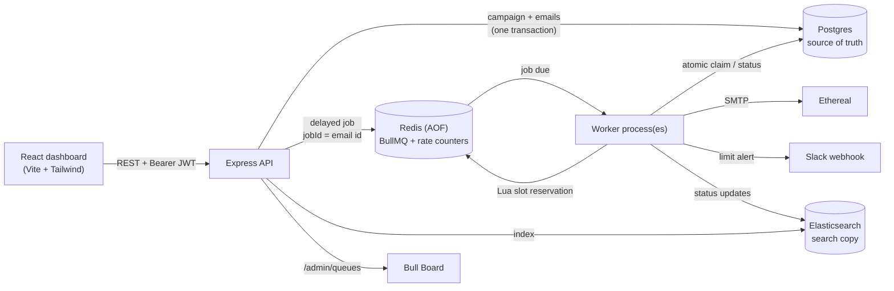
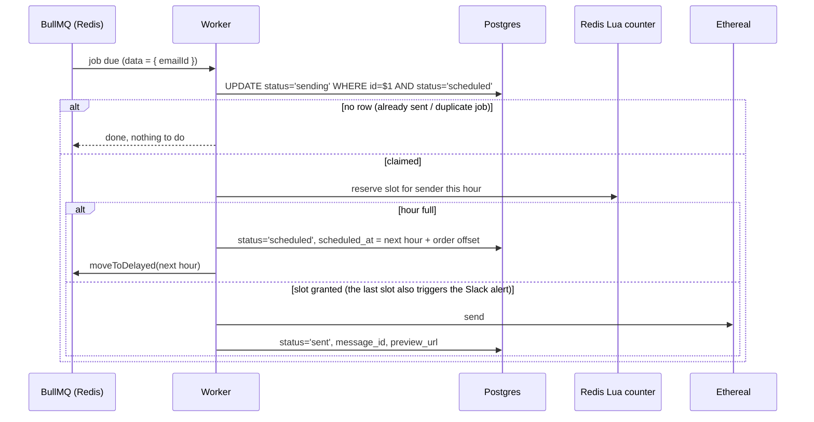

# Email Job Scheduler

A full-stack email campaign scheduler. You upload a CSV of recipients, pick a sender and a start time, and the system sends every email at its planned time through BullMQ delayed jobs. It survives server restarts, never sends the same email twice, and enforces hourly limits per sender across any number of workers.

Built for the ReachInbox take-home assignment.

🎥 **Demo video:** https://youtu.be/yeyLekNiiMo

---

## Contents

- [Features](#features)
- [Architecture](#architecture)
- [Quick start](#quick-start)
- [How it works](#how-it-works)
- [Configuration](#configuration)
- [API reference](#api-reference)
- [Testing](#testing)
- [Design decisions and trade-offs](#design-decisions-and-trade-offs)
- [Project structure](#project-structure)
- [Troubleshooting](#troubleshooting)

---

## Features

| Requirement | How it's met |
| --- | --- |
| Scheduling without cron | Every email is a BullMQ **delayed job** (`delay = scheduledAt − now`). No cron, `node-cron`, agenda or polling loop anywhere. |
| Survives restarts | Redis runs with **AOF persistence**. On startup, the worker's **reconciler** re-adds a job for every pending row in Postgres, which is the source of truth. Overdue emails go out immediately. Tested by hard-killing the worker mid-campaign and by wiping every job in Redis. |
| Never sends twice | Two layers: **jobId = email id**, so BullMQ ignores duplicate jobs, and an **atomic claim** (`UPDATE … SET status='sending' WHERE status='scheduled'`), so exactly one worker can win an email. |
| Rate limits from env, working across workers | `MAX_EMAILS_PER_HOUR_PER_SENDER` is enforced by an **atomic Redis Lua counter** keyed `rl:count:<senderId>:<hour>`. `MIN_DELAY_BETWEEN_SENDS_MS` uses BullMQ's Redis-backed limiter. `WORKER_CONCURRENCY` is read from env. |
| Hourly limit hit → next hour, in order | The job is moved with `job.moveToDelayed()` to the start of the next hour, plus an offset that keeps the original order. It is never failed or dropped. |
| Campaign hourly limit | A pure-function **planner** spreads send times so no clock hour gets more than the Compose form's limit. |
| Slack alerts | A real **"Connect Slack" OAuth flow** saves a webhook per user. The moment a sender hits its hourly cap, a message is posted. Users without Slack get no message and nothing breaks. |
| Search | Every email is indexed in **Elasticsearch**, with typo tolerance, search-as-you-type and highlighting, filtered to the current user's own emails. |
| Live queue dashboard | **Bull Board** at `/admin/queues`, behind a login. |
| Auth | **Google OAuth** (authorization code flow) on the backend. The API issues its own JWT, which the frontend sends as `Authorization: Bearer`. |
| Frontend | React + Vite + TypeScript + Tailwind: login, dashboard, Scheduled/Sent tabs, a Compose modal with CSV upload, search, toasts, and empty/loading states. |

> **Design:** no Figma was provided, so I designed a clean dashboard myself.

---

## Architecture



**Separate processes.** The **API** (`src/server.ts`) only saves and enqueues. The **worker** (`src/worker.ts`) only sends. You can run several workers against the same queue; the claim and the Redis counters keep them consistent.

**What happens to one email**



---

## Quick start

### Prerequisites

- **Docker Desktop**
- **Node.js 22+** (developed on Node 24)
- A **Google Cloud OAuth client** (Web application), with the redirect URI `http://localhost:4000/api/auth/google/callback`. While the app is in "Testing", add your Google account as a test user.
- For Slack alerts only:
  - a **Slack app** with *Incoming Webhooks* on and the scope `incoming-webhook`
  - an **ngrok** static domain, because Slack only redirects to HTTPS. The Slack redirect URL is `https://<your-ngrok-domain>/api/integrations/slack/callback`.

### 1. Infrastructure

```bash
docker compose up -d --wait      # Postgres 17, Redis 7.4 (AOF), Elasticsearch 8.17
```

### 2. Backend

```bash
cd backend
npm install
cp .env.example .env              # PowerShell: Copy-Item .env.example .env
# fill in JWT_SECRET, GOOGLE_*, SLACK_*, BULL_BOARD_PASSWORD (instructions are inside the file)
npm run seed:senders              # creates 2 Ethereal sender accounts through Ethereal's API
npm run dev                       # API on http://localhost:4000 (runs migrations on boot)
```

In a second terminal:

```bash
cd backend
npm run dev:worker                # the sender; start more of these for more throughput
```

### 3. Frontend

```bash
cd frontend
npm install
npm run dev                       # http://localhost:5173
```

### 4. Slack (optional)

```bash
ngrok http 4000 --url=https://<your-ngrok-domain>
```

Then click **Connect Slack** in the dashboard.

### Try it

1. Sign in with Google.
2. Click **Compose** and drop in [`samples/recipients.csv`](samples/recipients.csv). The preview reports **8 recipients · 1 duplicate removed · 2 lines skipped**: the header row, and one row with no valid address.
3. Set a start time a minute ahead and click **Schedule**. Rows move from *Scheduled* to *Sent* live; **View** opens the delivered email on Ethereal.
4. Watch the jobs at `http://localhost:4000/admin/queues` (username `admin`, password from `.env`).

---

## How it works

### Scheduling (no cron)

`POST /api/campaigns` validates the input (zod) and removes duplicate recipients (case-insensitive). The **planner** (`src/scheduler/planner.ts`, a pure function with unit tests) then assigns each email a send time: `startAt + i × delay`. When a clock hour reaches the campaign's hourly limit, the next email jumps to the start of the next hour.

The campaign and all its emails are inserted in **one transaction**, using a single `INSERT … SELECT FROM unnest(…)`. **Only after COMMIT** is one delayed job per email added with `addBulk`. The other order is unsafe: a job due immediately could run before its row is visible.

### Idempotency (never twice)

- **`jobId = email id`:** adding the same job twice is a no-op in BullMQ. This is what makes re-queuing always safe.
- **Atomic claim:** the worker must move the row from `scheduled` to `sending` in one `UPDATE … WHERE status = 'scheduled' RETURNING …`. Postgres row locking means that if two workers race, the second sees `sending` and updates 0 rows.
- **At-most-once on crashes:** if a worker dies *mid-send*, we can't know whether the SMTP server accepted the email. When BullMQ re-delivers that job, the worker finds the row still in `sending` and marks it `failed` ("interrupted") instead of retrying. A missed email is visible and can be resent by a person; a duplicate can't be taken back. A graceful shutdown (`worker.close()`) waits for active sends, so normal restarts never hit this.

### Restart safety

- Redis runs with `appendonly yes`, `appendfsync everysec` and `maxmemory-policy noeviction`, so delayed jobs survive a Redis restart and are never evicted.
- On every start, the worker's **reconciler** re-adds a job for every `scheduled` row, using keyset pagination with the remaining delay (0 if overdue). Duplicates are ignored because of the jobId, so this repairs *any* gap between Redis and Postgres. It runs once at startup, not on a timer.
- Rows stuck in `sending` for more than 10 minutes, where the worker died and Redis also lost the job, are marked failed for the same at-most-once reason.

### Throughput and rate limits

- **`WORKER_CONCURRENCY`:** parallel jobs per worker process.
- **`MIN_DELAY_BETWEEN_SENDS_MS`:** `limiter: { max: 1, duration }`. BullMQ keeps limiter state in Redis, so the gap holds across **all** workers.
- **`MAX_EMAILS_PER_HOUR_PER_SENDER`:** a Lua script runs atomically inside Redis:
  ```lua
  local used = tonumber(redis.call('GET', KEYS[1]) or '0')
  if used >= tonumber(ARGV[1]) then return -1 end
  used = redis.call('INCR', KEYS[1])
  if used == 1 then redis.call('EXPIRE', KEYS[1], ARGV[2]) end
  return used
  ```
  The key is `rl:count:<senderId>:<hourWindow>`, a new key per clock hour with a 2 h TTL, so nothing needs resetting. Check-and-increment is one indivisible step, so N workers can never exceed the cap.
- **Overflow:** the worker returns the claim, stores the new `scheduled_at`, and moves the *same* job with `job.moveToDelayed(nextHourStart + offset)`, then throws `DelayedError`. The offset is 1 ms per second of the email's original position in its hour, so overflowed emails keep their order and all land in the first ~3.6 s of the next hour.

### Slack

1. `POST /api/integrations/slack/connect` returns Slack's authorize URL, with `scope=incoming-webhook` and a signed 10-minute `state` JWT carrying the user id.
2. The user picks a channel and clicks Allow. Slack redirects to our HTTPS callback, via ngrok locally.
3. We verify the state, exchange the code (plus client secret) for the channel's webhook URL, and store it per user. It is never returned by the API.
4. When a reservation takes a sender's **last** slot of the hour (exactly one does, since the Lua script is atomic), the worker posts an alert. Recipients are the user who triggered it plus every user with emails pending for that sender this hour.
5. The alert is fire-and-forget with a 5 s timeout, so Slack being down never affects sending. Times use Slack's `<!date>` syntax, so each reader sees their own timezone.

### Search

Elasticsearch holds a **search copy** of the emails table. Writes to it are best-effort and never block scheduling or sending. `npm run reindex` rebuilds it from Postgres at any time; it's idempotent because document id = email id.

Queries combine:
- a fuzzy multi-match for typos
- a `bool_prefix` match for search-as-you-type
- a strict `userId` filter, which is the security boundary

Highlights use `encoder: html`, so the rendered snippets are XSS-safe.

---

## Configuration

All backend settings live in `backend/.env`; see [`backend/.env.example`](backend/.env.example). The server **validates every variable at startup** with zod and refuses to boot with a readable list of problems.

| Variable | Purpose |
| --- | --- |
| `PORT`, `FRONTEND_URL` | API port (4000), and the dashboard origin for CORS and redirects |
| `DATABASE_URL`, `REDIS_URL`, `ELASTICSEARCH_URL` | Infrastructure (defaults match `docker-compose.yml`) |
| `JWT_SECRET`, `JWT_EXPIRES_IN` | Signing key (≥ 32 characters) and lifetime of the API's own tokens |
| `GOOGLE_CLIENT_ID`, `GOOGLE_CLIENT_SECRET`, `GOOGLE_CALLBACK_URL` | Google OAuth client |
| `SLACK_CLIENT_ID`, `SLACK_CLIENT_SECRET`, `SLACK_REDIRECT_URI` | Slack app; the redirect must be `https://` |
| `BULL_BOARD_USERNAME`, `BULL_BOARD_PASSWORD` | Login for `/admin/queues` |
| `WORKER_CONCURRENCY` | Jobs in flight per worker process |
| `MIN_DELAY_BETWEEN_SENDS_MS` | Minimum gap between any two sends, across all workers (0 = off) |
| `MAX_EMAILS_PER_HOUR_PER_SENDER` | Hard cap per sender per clock hour, across all workers |

The rate limits have **no defaults in code**, so each environment has to set them explicitly.

The frontend has one optional variable: `VITE_API_URL`, which defaults to `http://localhost:4000`.

---

## API reference

| Method | Path | Auth | Description |
| --- | --- | --- | --- |
| GET | `/api/health` | – | Checks Postgres, Redis and Elasticsearch (each with a 3 s timeout). Returns `200` or `503`. |
| GET | `/api/auth/google` | – | Starts Google login (sets a CSRF `state` cookie) |
| GET | `/api/auth/google/callback` | – | Google redirect target. Upserts the user and redirects to `/auth/callback#token=…` |
| GET | `/api/auth/me` | Bearer | Current user, including Slack status |
| GET | `/api/senders` | Bearer | Sender accounts for the Compose form (no credentials) |
| POST | `/api/campaigns` | Bearer | Schedule a campaign: `{ senderId, subject, body, recipients[], startAt, delayBetweenMs, hourlyLimit }` |
| GET | `/api/emails?tab=scheduled\|sent&limit&offset` | Bearer | Dashboard tables |
| GET | `/api/emails/stats` | Bearer | Counts for the summary cards |
| GET | `/api/emails/search?q=&tab=` | Bearer | Full-text search (Elasticsearch) |
| POST | `/api/integrations/slack/connect` | Bearer | Returns the Slack authorize URL |
| GET | `/api/integrations/slack/callback` | signed state | Slack redirect target |
| POST | `/api/integrations/slack/test` | Bearer | Posts a test message to the connected channel |
| DELETE | `/api/integrations/slack` | Bearer | Disconnects Slack |
| GET | `/admin/queues` | Basic | Bull Board |

Errors always have the shape `{ "error": "...", "details"?: [...] }`. Validation errors list each invalid field.

---

## Testing

```bash
cd backend
npm test            # planner unit tests, incl. 200 randomised campaigns: no hour over the limit, order never reversed
npm run loadtest    # 1000 emails, all due at once; start 1-3 workers first
npm run typecheck
```

**Load test** (`src/tools/load-test.ts`): uses two *load-test senders* (SMTP host `loadtest.invalid`) whose messages are built but never sent over the network, so Ethereal isn't flooded. It checks the guarantees and cleans up after itself. A sample run with 3 workers, cap 200 per sender per hour and a 20 ms minimum gap:

```
PASS  Per-sender hourly cap held: busiest sender-hour sent 200, cap 200
PASS  No email sent twice: 400 sent, 400 unique message ids
PASS  Nothing dropped or failed: 400 sent + 600 deferred = 1000 of 1000, 0 failed
PASS  Overflow moved to the next hour: earliest deferred email now at 14:00:02.551Z
Handled 1000 jobs in 31.3 s
```

**Scenarios verified during development:**
- A hard-killed worker mid-campaign: 12 of 12 sent after restart, with 12 unique message ids.
- Every job wiped from Redis: the reconciler rebuilt them from Postgres and all were sent.
- Two workers with a 500 ms minimum gap: the smallest observed gap was 495 ms.
- Cap of 5 per hour: "limit reached" fired exactly once per sender-hour.
- Each deferred job's due time in Redis matched its `scheduled_at` in Postgres to the millisecond.
- A Slack alert was delivered for a connected user; for a user without Slack it was logged only, with no crash.
- A search with a typo ("roadmpa") still found the matching emails.
- The UI was exercised in headless Chrome, including the phone layout.

**Restart demo you can do by hand:**
1. Schedule 10 emails 5 s apart.
2. Press Ctrl+C in the worker after 3 have sent, and wait 20 s.
3. Run `npm run dev:worker` again. The log shows `reconciled: N pending email(s)`, the overdue emails go out immediately, and every recipient is sent exactly once.

---

## Design decisions and trade-offs

- **Postgres is the source of truth; Redis and Elasticsearch are rebuildable.** Jobs carry only `{ emailId }`, so the worker always reads the current state. The reconciler and `npm run reindex` rebuild Redis and ES from Postgres.
- **At-most-once over at-least-once.** A send interrupted by a crash is marked failed rather than retried, because a duplicate email can't be recalled. Temporary SMTP errors *are* retried: 5 attempts with exponential backoff.
- **Claim first, then reserve a rate-limit slot.** Only an email this worker has definitely won consumes capacity, so duplicate or stale jobs never waste slots.
- **"Hour" means a UTC clock hour.** The planner and the Redis counter use the same numbering (`floor(epochMs / 3_600_000)`), so both limits always agree. For users at UTC+5:30 (IST), those hours run from :30 to :30 on the local clock.
- **Raw SQL with `pg` and a small migration runner** instead of an ORM. The critical logic (the atomic claim, partial indexes, `unnest` bulk insert) is SQL-level and stays visible. Migrations run in a transaction under a Postgres advisory lock, so the API and worker can both start safely.
- **JWT in `localStorage`.** It survives reloads and is simple to send as a Bearer header. The XSS exposure is limited because React escapes all output, and the only injected HTML (search highlights) is escaped by Elasticsearch. Tokens carry an audience (`api` vs `slack-connect`) so the two kinds can't be swapped.
- **Slack `state` is a signed JWT, not a cookie,** because the callback arrives on the ngrok domain while the flow starts on localhost. Known limitation: it isn't bound to the browser session, so a user could be tricked into installing a channel onto someone else's account. Slack's consent screen reduces that risk.
- **Dashboard refreshes by polling** every 5 s while the browser tab is visible. That's simple and sufficient here; server push (SSE or WebSockets) would be the next step at scale.
- **Load-test senders** (`loadtest.invalid`, a reserved domain that can never resolve) exercise the whole pipeline without real SMTP traffic.

---

## Project structure

```
backend/
  migrations/001_initial_schema.sql   users, senders, campaigns, emails, slack_connections
  src/
    server.ts                         API entry: migrations, Express, graceful shutdown
    worker.ts                         Worker entry: reconciler, BullMQ Worker, limiter
    app.ts                            middleware order and routes
    config/env.ts                     zod-validated environment
    auth/                             Google OAuth, JWT, requireAuth
    campaigns/campaigns.service.ts    validation, planner, transaction, enqueue, index
    scheduler/planner.ts (+ test)     send-time planning and overflow timing
    scheduler/reconciler.ts           rebuild the queue from Postgres on startup
    queue/email-queue.ts              queue, job options, idempotent bulk add
    worker/send-email.processor.ts    claim -> reserve slot -> defer or send
    worker/sender-rate-limit.ts       Redis Lua counter
    worker/mailer.ts                  pooled SMTP transports (Nodemailer)
    integrations/slack/               OAuth, webhook storage, limit alerts
    search/email-index.ts             Elasticsearch mapping, indexing, search
    admin/bull-board.ts               dashboard + Basic auth
    tools/load-test.ts, reindex.ts    npm run loadtest / reindex
frontend/
  src/
    pages/                            Login, AuthCallback, Dashboard
    components/                       Header, EmailTable, ComposeModal, SearchResults, Toasts, ...
    auth/AuthContext.tsx              token lifecycle and route guard
    lib/                              API client, CSV parser, formatting
samples/recipients.csv                demo CSV
docker-compose.yml                    Postgres, Redis (AOF), Elasticsearch
```

---

## Troubleshooting

| Symptom | Fix |
| --- | --- |
| `Invalid environment configuration` on startup | The message lists each bad variable; compare with `backend/.env.example`. |
| `/admin/queues` only shows "Authentication required" | Open it in a normal browser. Embedded browsers (e.g. VS Code's) don't show the Basic-auth login prompt. |
| Google says "Access blocked" | Add your account under Google Auth Platform → Audience → Test users. |
| Slack "Connect" shows an ngrok error page | Start ngrok with your static domain. On the first visit, click **Visit Site** on ngrok's warning page. |
| Emails stay in *Scheduled* | A worker must be running: `npm run dev:worker`. |
| `npm error enoent ... package.json` | Run npm commands inside `backend/` or `frontend/`, not the repo root. |
| Search misses older emails | `cd backend && npm run reindex` |
